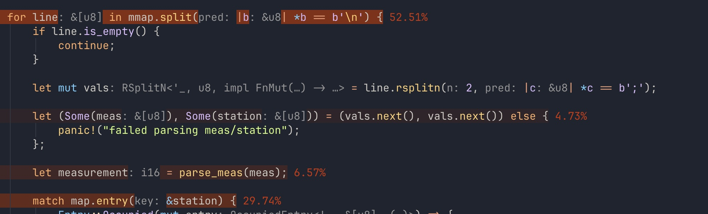

(WiP, this is mostly for me and also me. These docs are *very* scrappy.)

# samply_perfanno

A personal tool for converting a [samply](https://github.com/mstange/samply) Firefox profiler schema to a [perfanno.nvim](https://github.com/t-troebst/perfanno.nvim) flamegraph schema, primarily for profiling Rust applications.

This was entirely because

- Samply was the least painful profiler on macOS
- I wanted pretty perf annotations inside Neovim buffers via perfanno
- Perfanno does not support the firefox profiler schema

Quick preview of how it looks in Neovim when everything is working:



Unfortunately this was slightly easier said than done. The Firefox profiler schema only contains a series of tables listing the samples/libraries/functions, *not* the symbol mappings required to trace it back to any source code. Under the hood the Firefox Profiler handles this via requesting a Samply server serving any symbol map requests. This is less than ideal, as the flamegraph schema documented [here](https://github.com/brendangregg/FlameGraph) requires all symbols to be computed beforehand.

This little application effectively replaces the job of the Samply server by walking the sample stacks, doing symbolification, sample counting etc. and dumping it into a flamegraph-compatible format


# Usage 

Use samply to record as normal. If using this as part of a keybind I recommend disabling the auto-firefox open via `--save-only`:

```
samply record ./some-binary
```

Then run the converter tool:

```
cargo run <path/to/samply/profile.json.gz> <path/to/directory/samply/ran/in> -o perf.log
```

With a `perf.log` within the root project directory of your chosen project, you can now load your perf annotations in Neovim via `perfanno`:


```
:PerfLoadFlameGraph
```

---

Naming this repository samply_flamegraph might make more sense, but the name closely resembling Simply Piano was too funny.
